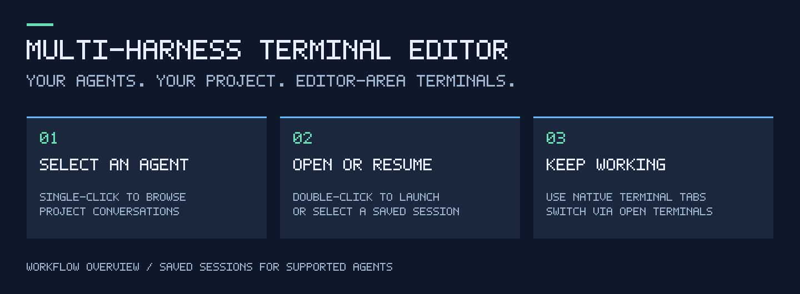
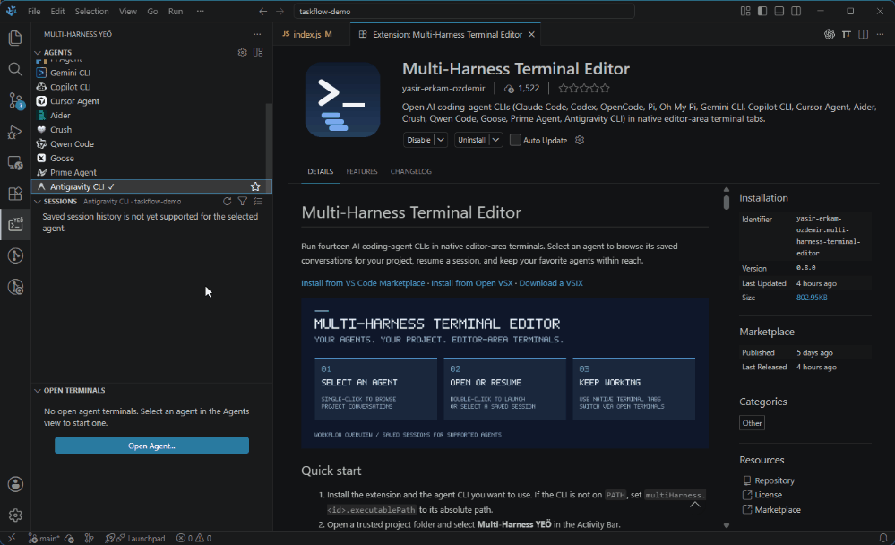

# Multi-Harness Terminal Editor

Run fourteen AI coding-agent CLIs in native editor-area terminals. Select an agent to browse its saved conversations for your project, resume a session, and keep your favorite agents within reach.

[Install from VS Code Marketplace](https://marketplace.visualstudio.com/items?itemName=yasir-erkam-ozdemir.multi-harness-terminal-editor) · [Install from Open VSX](https://open-vsx.org/extension/yasir-erkam-ozdemir/multi-harness-terminal-editor) · [Download a VSIX](https://github.com/yasir-erkam/Multi-Harness-Terminal-Editor/releases/latest)





<!-- Screenshot placeholder: uncomment once a clean capture exists in docs/images/ (see docs/images/README.md).

-->

## Quick start

1. Install the extension and the agent CLI you want to use. If the CLI is not on `PATH`, set `multiHarness.<id>.executablePath` to its absolute path.
2. Open a trusted project folder and select **Multi-Harness YEÖ** in the Activity Bar.
3. **Single-click an agent** to show its saved conversations for the current project.
4. **Double-click the agent** to open its editor-area terminal, or select a saved conversation to resume it.
5. Use the star to favorite an agent and the gear to open extension settings.

Saved conversations are supported for **Codex, Claude Code, Pi, Oh My Pi and Prime Agent**. All fourteen agents can open terminals. **Open Terminals** focuses an existing tab; **Sessions** shows saved history, including conversations whose terminal tabs are closed.

The native list is the default. Switch to cards from the view header for search and larger icons. Favorites and the selected agent are shared between layouts; the selected agent is remembered per workspace.

## What it is

Multi-Harness Terminal Editor opens AI coding-agent CLIs — "harnesses" — as **native VS Code terminals in the editor area**. Open any of the fourteen supported agents from the Activity Bar launcher, an optional editor title-bar button, or the agent picker. Editor title-bar buttons ship **off by default** and are toggled on per agent. The terminals are ordinary editor-area terminals: they can be split, moved, reordered and closed like any other tab.

## Features

- **Two sidebar layouts.** The sidebar defaults to the native VS Code list. Use the Switch Sidebar Layout button in the view header, or set `multiHarness.sidebarLayout` to `native` or `cards`. Cards add search, larger agent icons and integrated session lists. Both layouts share favorites, the selected agent and project filter, settings and launch commands. Your layout choice is saved in VS Code settings.

- **Activity Bar launcher.** The Multi-Harness YEÖ sidebar lists all fourteen agents and includes a gear button for extension settings. Click an agent once to select it and show its saved sessions for the current project; double-click to open its terminal. Both sidebar layouts use this behavior.
- **Favorite agents.** Hover over an agent and click the star to keep it at the top of the sidebar. Click the filled star to remove it. Favorites persist across window reloads and workspaces in the same VS Code profile.
- **Saved sessions.** The Sessions view lists up to 100 recent conversations for the selected agent whose recorded working directory matches the current project folder. Launch an agent, focus its terminal, or use Select Session Agent in the Sessions header to change the agent filter. In multi-root workspaces the folder follows the active editor and stays selected while focus moves to the sidebar or terminal. Symlink aliases match the same directory. This preview supports Codex, Claude Code, Pi, Oh My Pi and Prime Agent. Click a conversation to resume its exact record; closed tabs do not remove saved history. Use Refresh Sessions for new records and title changes. Unsupported agents show an explanation instead of another agent's history.
- **Open terminals.** The Open Terminals view lists open agent terminal tabs, including resumed sessions. Click a row to focus that exact terminal. A dot marks the active terminal. This is separate from saved conversation history and does not claim to track agent process state.
- **Delete saved conversations.** Use a session's trash button (or the native list's right-click menu) for one conversation. Choose Select in Sessions to enter selection mode, mark conversations with checkboxes, then Delete Selected. Select All selects the currently listed agent/project results (up to 100); in cards it also respects the search field. Selections survive refreshes and title changes, are shared between layouts, and clear when you change agents or projects. The confirmation lists the selected titles. The extension first tries Trash / Recycle Bin; if that fails, permanent deletion requires a separate explicit confirmation. Unsuccessful deletions remain selected. Only the selected conversation's JSONL file is removed; auxiliary indexes, artifacts and unrelated history are preserved. Files containing multiple conversation identities are refused. Open terminals stay running and can write new history. On older VS Code builds without native tree checkboxes, selection uses check marks and row clicks; cards always show checkboxes.
- **Fourteen agents, one terminal each.** Open any supported harness in its own editor-area terminal. Each agent is keyed by an id (for example `claudeCode`, `openCode`, `ohMyPi`) that drives its command, its settings and its icon.
- **One terminal per agent, reused.** Running the command again reveals the agent's existing terminal instead of starting a second process; terminals are matched by the agent's display name.
- **Sessions use the full editor area by default.** Opening or focusing an agent terminal joins split editor groups into a single group, preserving all open tabs. Set `multiHarness.useFullEditorArea` to `false` to keep your split layout. Terminal profiles open in the active editor group without adding a split. Terminals are marked `isTransient`, so they are not restored on window reload.
- **Agent picker.** `multiHarness.openAgentPicker` — **Multi-Harness: Open Agent...** in the Command Palette — shows a Quick Pick over all fourteen harnesses and opens the one you choose; handy when you keep the title-bar icons hidden.
- **Optional shell launch mode with live status.** `multiHarness.launchMode: "shell"` runs agents through your shell so a status-bar item can report running/finished state, duration and exit code; the default `direct` mode is unchanged. See [Launch modes](#launch-modes).
- **Terminal profile dropdown.** Every agent is also contributed as a VS Code terminal profile (`multiHarness.<id>`), so you can start one from the terminal panel's `+` dropdown; profiles whose executable cannot be resolved are simply omitted from the list.
- **Per-agent editor title-bar icons.** Every agent has its own toggle, `multiHarness.show<Id>Icon` (boolean, default `false`). Enable only the agents you want in the editor title bar.
- **Exit notifications.** With `multiHarness.notifyOnExit` enabled (default `false`), the extension shows a notification containing the exit code when an agent terminal closes, so a crashed or non-zero CLI does not pass unnoticed.
- **Multi-root workspaces.** Agent terminals use a workspace folder as their working directory; the extension does not assume a single-folder workspace.
- **Configurable launch.** For each agent you can override the executable with `multiHarness.<id>.executablePath` and add extra CLI flags with `multiHarness.<id>.arguments`.
- **No runtime dependencies.** The extension is pure VS Code API code.

## Other ways to open an agent

- Run **Multi-Harness: Open Agent...** in the Command Palette, or one of the **Multi-Harness: Open &lt;Agent&gt;** commands.
- Choose an agent from the terminal profile dropdown.
- Enable its `multiHarness.show<Id>Icon` setting to add an editor title-bar button. These buttons are off by default; the Activity Bar launcher is always available.

## Supported agents

| Harness id | Display name | Open command | Default executable |
| --- | --- | --- | --- |
| `claudeCode` | Claude Code | `multiHarness.openClaudeCode` | `claude` |
| `codex` | Codex | `multiHarness.openCodex` | `codex` |
| `openCode` | OpenCode | `multiHarness.openOpenCode` | `opencode` |
| `pi` | Pi Agent | `multiHarness.openPi` | `pi` |
| `ohMyPi` | Oh My Pi | `multiHarness.openOhMyPi` | `omp` |
| `gemini` | Gemini CLI | `multiHarness.openGemini` | `gemini` |
| `copilot` | Copilot CLI | `multiHarness.openCopilot` | `copilot` |
| `cursorAgent` | Cursor Agent | `multiHarness.openCursorAgent` | `cursor-agent` |
| `aider` | Aider | `multiHarness.openAider` | `aider` |
| `crush` | Crush | `multiHarness.openCrush` | `crush` |
| `qwen` | Qwen Code | `multiHarness.openQwen` | `qwen` |
| `goose` | Goose | `multiHarness.openGoose` | `goose` |
| `primeAgent` | Prime Agent | `multiHarness.openPrimeAgent` | `prime-agent` |
| `antigravity` | Antigravity CLI | `multiHarness.openAntigravity` | `agy` |

Install [Antigravity CLI](https://antigravity.google/download#antigravity-cli) in the environment where the extension runs (the code-server container for remote development). Its command is `agy`; default locations are `~/.local/bin/agy` on Linux/macOS and `%LOCALAPPDATA%\agy\bin` on Windows. Both are discovered automatically. Antigravity saved-session browsing is not supported yet.

## Commands

All commands appear in the Command Palette under the `Multi-Harness` category. The fourteen `open*` commands are also individual, keybindable commands.

| Command ID | Palette label | Description |
| --- | --- | --- |
| `multiHarness.openAgentPicker` | Open Agent... | Quick Pick over all fourteen harnesses. |
| `multiHarness.openSettings` | Open Settings | Open settings filtered to this extension. |
| `multiHarness.openClaudeCode` | Open Claude Code | Open a Claude Code terminal. |
| `multiHarness.openCodex` | Open Codex | Open a Codex terminal. |
| `multiHarness.openOpenCode` | Open OpenCode | Open an OpenCode terminal. |
| `multiHarness.openPi` | Open Pi Agent | Open a Pi Agent terminal. |
| `multiHarness.openOhMyPi` | Open Oh My Pi | Open an Oh My Pi terminal. |
| `multiHarness.openGemini` | Open Gemini CLI | Open a Gemini CLI terminal. |
| `multiHarness.openCopilot` | Open Copilot CLI | Open a Copilot CLI terminal. |
| `multiHarness.openCursorAgent` | Open Cursor Agent | Open a Cursor Agent terminal. |
| `multiHarness.openAider` | Open Aider | Open an Aider terminal. |
| `multiHarness.openCrush` | Open Crush | Open a Crush terminal. |
| `multiHarness.openQwen` | Open Qwen Code | Open a Qwen Code terminal. |
| `multiHarness.openGoose` | Open Goose | Open a Goose terminal. |
| `multiHarness.openPrimeAgent` | Open Prime Agent | Open a Prime Agent terminal. |
| `multiHarness.openAntigravity` | Open Antigravity CLI | Open an Antigravity CLI terminal. |

## Settings

Every setting lives under the `multiHarness` section.

For the five supported session providers, `multiHarness.<id>.sessionDirectory`
can override the session storage root with an absolute path (or a path starting
with `~/`). Leave it empty to use the agent's default store. Conversation files
are read locally, with bounded metadata reads; missing or malformed records are
skipped, and directory access failures appear in the session list. A saved
session cannot resume if its file or original project directory is unavailable.

If an agent moves its session store or changes to an unrecognized file format,
Sessions stays empty and the terminal launcher remains usable. Set
`multiHarness.<id>.sessionDirectory` to the new storage directory when known,
then refresh Sessions. A path override supports a moved store; a changed file
format may require an extension update.

Agent or project changes cancel outdated scans. Archive traversal is limited to
20,000 entries; a notice indicates incomplete results or access failures.
After fixing a path or permission, use **Refresh Sessions** to try again.
Resumed conversations use their recorded project's CLI settings and directory.

### Full settings reference

**Editor layout**

| Setting | Type | Default | Scope |
| --- | --- | --- | --- |
| `multiHarness.useFullEditorArea` | `boolean` | `true` | `window` |

Enabled: opening, resuming or focusing an agent terminal joins editor groups,
preserving all open tabs. Disabled: terminals use their existing group or open
in the active group, keeping the split layout. The setting applies on the next
interaction without reloading; disabling it does not restore previously joined
groups. Terminal profile launches always use the active group.

**Icon toggles — `multiHarness.show<Id>Icon`**

| Setting | Type | Default | Scope |
| --- | --- | --- | --- |
| `multiHarness.showClaudeCodeIcon` | `boolean` | `false` | `window` |
| `multiHarness.showCodexIcon` | `boolean` | `false` | `window` |
| `multiHarness.showOpenCodeIcon` | `boolean` | `false` | `window` |
| `multiHarness.showPiIcon` | `boolean` | `false` | `window` |
| `multiHarness.showOhMyPiIcon` | `boolean` | `false` | `window` |
| `multiHarness.showGeminiIcon` | `boolean` | `false` | `window` |
| `multiHarness.showCopilotIcon` | `boolean` | `false` | `window` |
| `multiHarness.showCursorAgentIcon` | `boolean` | `false` | `window` |
| `multiHarness.showAiderIcon` | `boolean` | `false` | `window` |
| `multiHarness.showCrushIcon` | `boolean` | `false` | `window` |
| `multiHarness.showQwenIcon` | `boolean` | `false` | `window` |
| `multiHarness.showGooseIcon` | `boolean` | `false` | `window` |
| `multiHarness.showPrimeAgentIcon` | `boolean` | `false` | `window` |
| `multiHarness.showAntigravityIcon` | `boolean` | `false` | `window` |

**Executable overrides — `multiHarness.<id>.executablePath`** (machine-overridable; reset the setting to use the default executable)

| Setting | Type | Default | Scope |
| --- | --- | --- | --- |
| `multiHarness.claudeCode.executablePath` | `string` | `"claude"` | machine-overridable |
| `multiHarness.codex.executablePath` | `string` | `"codex"` | machine-overridable |
| `multiHarness.openCode.executablePath` | `string` | `"opencode"` | machine-overridable |
| `multiHarness.pi.executablePath` | `string` | `"pi"` | machine-overridable |
| `multiHarness.ohMyPi.executablePath` | `string` | `"omp"` | machine-overridable |
| `multiHarness.gemini.executablePath` | `string` | `"gemini"` | machine-overridable |
| `multiHarness.copilot.executablePath` | `string` | `"copilot"` | machine-overridable |
| `multiHarness.cursorAgent.executablePath` | `string` | `"cursor-agent"` | machine-overridable |
| `multiHarness.aider.executablePath` | `string` | `"aider"` | machine-overridable |
| `multiHarness.crush.executablePath` | `string` | `"crush"` | machine-overridable |
| `multiHarness.qwen.executablePath` | `string` | `"qwen"` | machine-overridable |
| `multiHarness.goose.executablePath` | `string` | `"goose"` | machine-overridable |
| `multiHarness.primeAgent.executablePath` | `string` | `"prime-agent"` | machine-overridable |
| `multiHarness.antigravity.executablePath` | `string` | `"agy"` | machine-overridable |

**Extra arguments — `multiHarness.<id>.arguments`**

| Setting | Type | Default | Scope |
| --- | --- | --- | --- |
| `multiHarness.claudeCode.arguments` | `array` of `string` | `[]` | `resource` |
| `multiHarness.codex.arguments` | `array` of `string` | `[]` | `resource` |
| `multiHarness.openCode.arguments` | `array` of `string` | `[]` | `resource` |
| `multiHarness.pi.arguments` | `array` of `string` | `[]` | `resource` |
| `multiHarness.ohMyPi.arguments` | `array` of `string` | `[]` | `resource` |
| `multiHarness.gemini.arguments` | `array` of `string` | `[]` | `resource` |
| `multiHarness.copilot.arguments` | `array` of `string` | `[]` | `resource` |
| `multiHarness.cursorAgent.arguments` | `array` of `string` | `[]` | `resource` |
| `multiHarness.aider.arguments` | `array` of `string` | `[]` | `resource` |
| `multiHarness.crush.arguments` | `array` of `string` | `[]` | `resource` |
| `multiHarness.qwen.arguments` | `array` of `string` | `[]` | `resource` |
| `multiHarness.goose.arguments` | `array` of `string` | `[]` | `resource` |
| `multiHarness.primeAgent.arguments` | `array` of `string` | `[]` | `resource` |
| `multiHarness.antigravity.arguments` | `array` of `string` | `[]` | `resource` |

**Notifications**

| Setting | Type | Default | Scope |
| --- | --- | --- | --- |
| `multiHarness.notifyOnExit` | `boolean` | `false` | `window` |

### Example `settings.json`

```json
{
  "multiHarness.showClaudeCodeIcon": true,
  "multiHarness.showOhMyPiIcon": true,
  "multiHarness.claudeCode.executablePath": "/usr/local/bin/claude",
  "multiHarness.claudeCode.arguments": ["--model", "opus"],
  "multiHarness.ohMyPi.executablePath": "/home/me/.bun/bin/omp",
  "multiHarness.notifyOnExit": true
}
```

## Keyboard shortcuts & focus

**How keys reach a focused terminal.** When a terminal has focus, keystrokes are delivered to the terminal *except* for the commands listed in `terminal.integrated.commandsToSkipShell`. That list is seeded with a built-in set of VS Code commands and can be written to by the user: adding a command ID makes VS Code handle the key instead of the terminal, and prefixing an entry with `-` removes it from the list.

**Ctrl+P opens Quick Open instead of reaching the agent.** `workbench.action.quickOpen` (Ctrl+P) is in that default skip list, so in an editor-area terminal Ctrl+P opens Quick Open rather than being forwarded to the CLI. To hand Ctrl+P back to the shell, add the removal entry — the example VS Code's own docs give for "Send quick open's keyboard shortcut to the shell":

```json
"terminal.integrated.commandsToSkipShell": ["-workbench.action.quickOpen"]
```

**Ctrl/Cmd+W closes the terminal editor tab.** In an **editor-area** terminal, `Ctrl/Cmd+W` is bound to `workbench.action.terminal.killEditor` ("Kill the Active Terminal in Editor Area") with `when: terminalFocus && terminalEditorFocus`, and `workbench.action.terminal.killEditor` is itself in the default `commandsToSkipShell` list — so VS Code consumes the chord and it does **not** reach the agent process. In a **panel** terminal the `terminalEditorFocus` guard does not match and the fallback editor-close binding is *not* in the skip list, so there the key is forwarded to the shell. On Windows the primary binding is `Ctrl+F4`, with `Ctrl+W` as the secondary. (VS Code source: `terminalActions.ts` in `src/vs/workbench/contrib/terminal/browser/`, and `DEFAULT_COMMANDS_TO_SKIP_SHELL` in `src/vs/workbench/contrib/terminal/common/terminal.ts`.)

**Ctrl+C and copy.** On Windows, `Ctrl+C` copies only when text is selected: the `win`-only keybinding of `workbench.action.terminal.copyAndClearSelection` (also in the default skip list) is gated on the `textSelected` context key, so with nothing selected the chord reaches the agent and still interrupts a running CLI. On Linux, plain `Ctrl+C` always reaches the agent because copy is `Ctrl+Shift+C` (`workbench.action.terminal.copySelection`); on macOS, `Cmd+C` copies when a selection exists.

**Sending most keys to the terminal.** Setting `terminal.integrated.sendKeybindingsToShell` to `true` dispatches most keybindings to the terminal instead of VS Code, overriding `commandsToSkipShell`. The documented cost is that terminal-local VS Code shortcuts — Ctrl+F find, for example — stop working while the terminal is focused.

**Chords and mnemonics.** `terminal.integrated.allowChords` (default `true`) sends chorded keybindings to VS Code; note that when a keystroke forms a chord it bypasses `commandsToSkipShell`, and setting this to `false` is how you let e.g. `Ctrl+K` reach the shell. `terminal.integrated.allowMnemonics` (default `false`) concerns Alt+letter menu mnemonics — it controls whether those combinations open the menu bar while the terminal is focused (no effect on macOS).

## Fonts & icons (Nerd Font, ligatures)

**Font family.** `terminal.integrated.fontFamily` has no default value. When it is unset the terminal falls back to `editor.fontFamily`, and whatever value is in effect VS Code always appends `, monospace` (and on macOS also `, AppleBraille`).

**Ligatures.** `terminal.integrated.fontLigatures.enabled` defaults to `false`. When you enable it you can tune the behavior with `terminal.integrated.fontLigatures.featureSettings` (the default is `"calt" on`) and `terminal.integrated.fontLigatures.fallbackLigatures`.

**GPU acceleration.** `terminal.integrated.gpuAcceleration` accepts `auto` (default), `on` or `off`. `auto` selects the WebGL renderer and falls back to the DOM renderer when WebGL fails to load or its context is lost.

**Nerd Font icons.** With the WebGL renderer, `terminal.integrated.customGlyphs` (default `true`) draws a specific set of ranges itself, so these glyphs render even without a patched font in the stack:

- Box Drawing `U+2500`–`U+257F`
- Block Elements `U+2580`–`U+259F`
- Braille Patterns `U+2800`–`U+28FF`
- Powerline `U+E0A0`–`U+E0D4`
- Progress `U+EE00`–`U+EE0B`
- Git Branch `U+F5D0`–`U+F60D`
- Symbols for Legacy Computing `U+1FB00`–`U+1FBFF`

All other Nerd Font private-use-area icons need a patched font in the font stack. Setting `terminal.integrated.gpuAcceleration` to `off` disables the custom-glyph path entirely, so the ranges above also require a patched font.

## Restricted Mode

This extension declares `untrustedWorkspaces: { supported: false }`, so it is disabled while the workspace is in Restricted Mode (Workspace Trust has not been granted). Agents run commands inside your workspace, so the extension does not activate until you trust the folder. Trust the workspace or add it to your trusted folders to enable the icons, commands and terminals.

It also declares `virtualWorkspaces: { supported: false }`, so it remains disabled in virtual workspaces (for example GitHub Repositories), where spawning a local CLI process is not possible.

## Launch modes

`multiHarness.launchMode` (default `direct`) picks how an agent terminal starts:

- **`direct`** — the agent CLI *is* the terminal process: the extension passes its path as `shellPath`. Same behaviour as every release before 0.3.0.
- **`shell`** — the user's default shell profile starts instead, and the agent is run as a command inside it. That indirection is what makes command-level reporting possible, so shell mode is the only mode with the live status-bar readout: `$(sync~spin) <Agent>` while a command runs, then `$(check) <Agent> — <seconds>s (exit <code>)` (or `$(error) …`, and `exit ?` when the shell reports no code). The item hides itself ~30 s after the last command.

Status tracking is best-effort by design. Within 10 s of creating the terminal the extension waits for shell integration and then runs the agent with `executeCommand(executable, args)`, letting VS Code handle quoting. If integration never activates, it falls back to a quoted command line (`sendText`) and says so once in a non-blocking message — with a POSIX single-quote rule (`'` becomes `'\''`), or double quotes with doubled `"` on Windows.

Known limitations of shell mode (all shell-integration related, none specific to this extension):

- `cmd.exe` on Windows has no shell integration, so it always takes the degraded path.
- A complex `PROMPT_COMMAND`, a non-standard shell prompt, or a subshell opened by your shell rc can prevent activation.
- Plain `ssh` sessions report through the *remote* shell; without Remote-SSH the local prompt is not shell-integrated.
- If shell integration injection is disabled in your VS Code settings, activation never happens.
- Terminal profiles from the profile dropdown always use direct mode: a profile has to return a runnable terminal, and the profile API offers no hook to await shell integration.

The shell-integration API is stable since VS Code 1.93. The extension still declares `engines.vscode: ^1.67.0`, feature-detects the API at runtime, and falls back to a direct-mode terminal when it is unavailable — so nothing breaks on older VS Code, shell mode simply behaves as `direct` there.

## Requirements

- **VS Code 1.67.0 or newer** (`engines.vscode: ^1.67.0`). The extension uses `TerminalOptions.location` / `TerminalLocation` (stable since 1.64), `isTransient` (stable since 1.65) and `window.tabGroups` with `TabInputTerminal` (stable since 1.67). Shell mode additionally needs the shell-integration API from **1.93+**; on older builds it degrades to direct launching (feature-detected at runtime).
- **A trusted, non-virtual workspace.** Because of the two capability declarations above, the extension does not activate in Restricted Mode or in virtual workspaces.
- `extensionKind: ["workspace"]` — it runs in the workspace extension host, where the terminal API is available.
- No runtime dependencies, and no Node.js/npm needed just to use the extension.

## Known limitations

- **Stale `PATH`.** The extension host does not source your shell rc files, so a CLI installed *after* VS Code started may not be on `PATH` in that window. That is why the extension looks for the agent executable beyond `PATH`:
  - `<workspace>/node_modules/.bin`, then
  - on Windows `%APPDATA%\npm` and `%LOCALAPPDATA%\pnpm`, and
  - on POSIX `~/.bun/bin`, `~/.local/bin` and `~/.npm-global/bin`,
  - before finally falling back to `PATH`.

  On Windows, if those lookups fail, fnm installations are also searched: `FNM_DIR`, `%APPDATA%\fnm`, `%LOCALAPPDATA%\fnm` and `~/.fnm`. The default Node alias is tried first, followed by installed Node versions from newest to oldest. This finds npm-installed agents even when PowerShell's temporary `fnm_multishells` path is absent from the extension host. Existing workspace, user-directory and `PATH` matches retain precedence. Installations are checked again on each launch, so a CLI installed later can be discovered without reloading.

  If an agent still is not found, set `multiHarness.<id>.executablePath` to its full path in the environment where the extension runs. For fnm, use the permanent `node-versions/<version>/installation/<agent>.cmd` path rather than a temporary `fnm_multishells` path.
- **Status reporting requires shell mode.** Direct mode does not report agent process state. Shell mode reports command start and finish when shell integration is available; it does not detect when an agent needs input.
- **Editor title-bar buttons are off by default.** Enable the matching `multiHarness.show<Id>Icon` setting to show them. The Multi-Harness Activity Bar launcher is available by default; you can also use `multiHarness.openAgentPicker`.

## Installation

### From the Marketplace

1. Open the Extensions view (`Ctrl+Shift+X`).
2. Search for **Multi-Harness Terminal Editor** and check the publisher shown on the result.
3. Click **Install**, then reload the window if prompted.
4. Open **Multi-Harness YEÖ** in the Activity Bar. Optionally enable editor title-bar buttons with the `multiHarness.show<Id>Icon` settings.

For code-server and other Open VSX clients, install from [Open VSX](https://open-vsx.org/extension/yasir-erkam-ozdemir/multi-harness-terminal-editor), or use the VSIX below.

### From a VSIX file

1. Open the Extensions view and open the `…` (Views and More Actions) menu.
2. Choose **Install from VSIX…** and select the downloaded `.vsix` file.
3. Alternatively, from a terminal: `code --install-extension artifacts/multi-harness-terminal-editor-0.6.1.vsix`.

Get the current VSIX from [GitHub Releases](https://github.com/yasir-erkam/Multi-Harness-Terminal-Editor/releases/latest).

VSIX files are produced in `artifacts/` by `npm run package` (see [PUBLISHING.md](PUBLISHING.md)).

## Development

```bash
npm ci          # install dev dependencies from the lockfile
npm run check   # type check (tsc --noEmit)
npm run build   # bundle src/extension.ts to dist/extension.js with esbuild
npm run test    # unit tests plus manifest validation
npm run compile # check + build + test
npm run package # check + build + test, then artifacts/<name>-<version>.vsix
npm run dev:install # same validation and packaging, then install into local code-server
npm run icons   # regenerate all themed harness icons from vendored sources
```

For browser-based code-server (including Docker on Ubuntu Server), use
`npm run dev:install`, then run **Developer: Reload Window** in the Command
Palette. Enable the desired `multiHarness.show<Id>Icon` settings, check the icons
in light/dark themes and click a button to verify its terminal opens. Installation
uses `/usr/local/bin/install-extension` when available, otherwise the bundled
`/app/code-server/bin/code-server` CLI. These commands only install locally.

If Node/npm are not on PATH in the container, run the same workflow directly:

```bash
/app/code-server/lib/node scripts/dev.mjs install
```

The workflow reports its actual Node version. Node 22 remains the CI standard.
Build output belongs in `dist/`, temporary test bundles in `.build/`, and VSIX
packages in `artifacts/`. These directories are ignored by Git; old packages can
be retained in `artifacts/`, and rebuilding the same version replaces its package.

For desktop VS Code, press <kbd>F5</kbd> to launch the **Extension Development Host**.

`.github/workflows/ci.yml` runs `npm run package` (including check, build and tests)
on every push and pull request. `.github/workflows/release.yml` uses the same
package command on `v*` tags and publishes the exact versioned file from
`artifacts/`, attaching it to the GitHub release.

### Source repository

The extension slug `multi-harness-terminal-editor` (the marketplace name) and the GitHub repository name are different things: the repository is PascalCase at `https://github.com/yasir-erkam/Multi-Harness-Terminal-Editor.git`, matching the `repository` field in `package.json`. To push the source there (never push from CI or automated tooling without review), assuming the `origin` remote is already configured — origin zaten ayarlı: `https://github.com/yasir-erkam/Multi-Harness-Terminal-Editor.git`:

```bash
git push -u origin main
```

After each commit the tip moves; the local history is authoritative, and `git log --oneline | head -3` prints the current top three.

## License

MIT. See [LICENSE](LICENSE).

## Icon credits

Editor title-bar and terminal icons use the harnesses' application marks,
including Claude Code's mascot, GitHub Copilot's robot, Gemini CLI's terminal
mark, and Crush's pixel heart. Ten use upstream website or application assets;
Claude Code, Codex and GitHub Copilot use the corresponding LobeHub brand marks.
Brand colors are preserved; monochrome foregrounds adapt to light/dark themes.
Sources and licenses are recorded in
[media/THIRD_PARTY_NOTICES.md](media/THIRD_PARTY_NOTICES.md).
Regenerate all 26 icons offline with `node scripts/gen-icons.mjs`.
